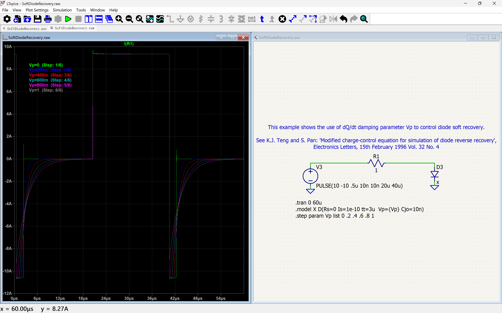

# Personal LTspice config file backup  
changes from the original:
- direction of mouse wheel rotation
- schematic color preferences
- schematic shortcut keys
- grid, line, cursor settings
- other minor changes over the years I can't remember

example screenshot:

---
## How to use:
The normal path for LTspice.ini is `~\AppData\Roaming` (for Windows), **first backup your config**, than move the modified file to that location

## NOTE:
This config file is for LTspice version 26.1.1, it might not be compatible with other historical versions or upcoming releases.